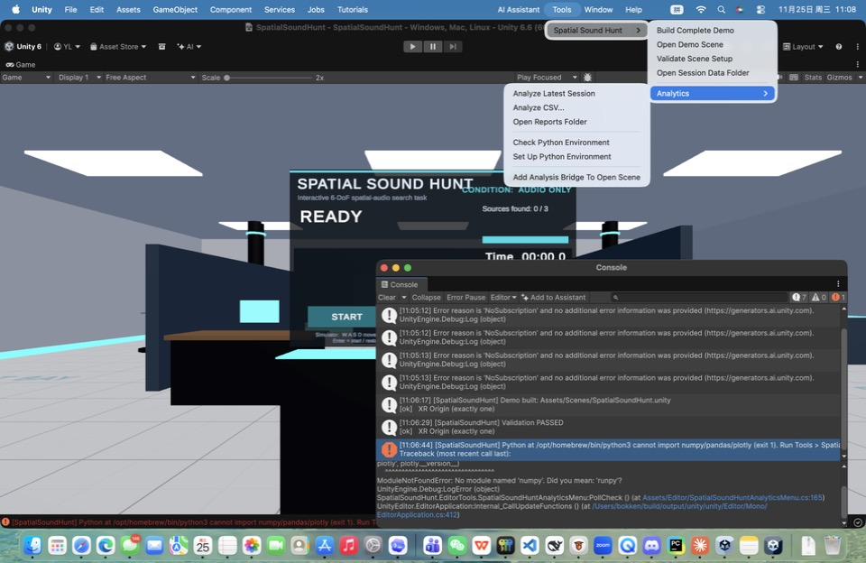
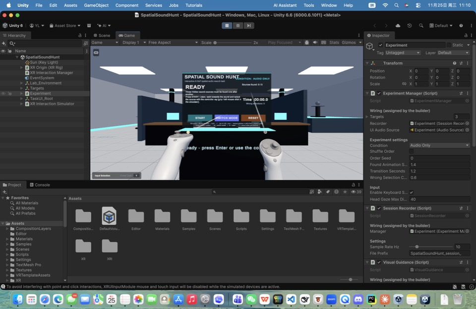
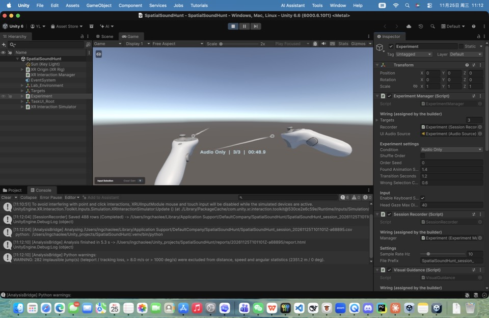
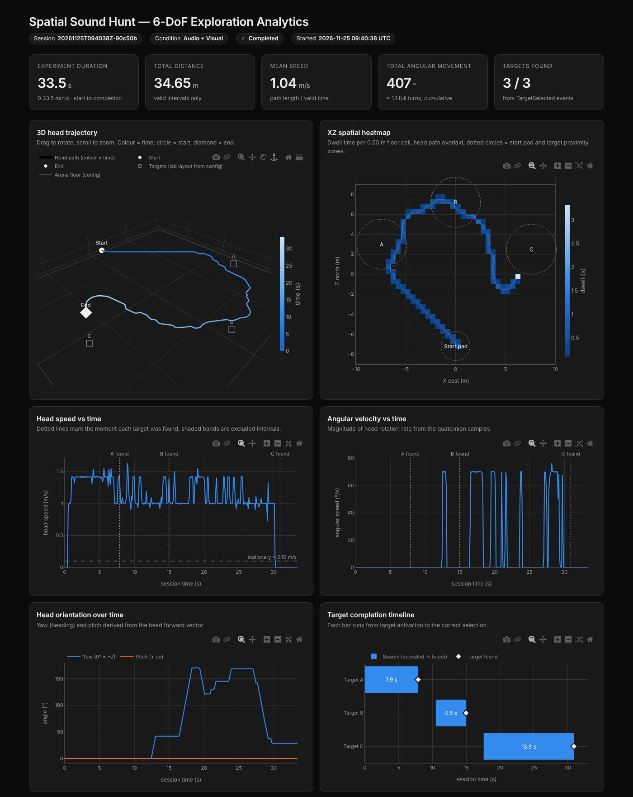
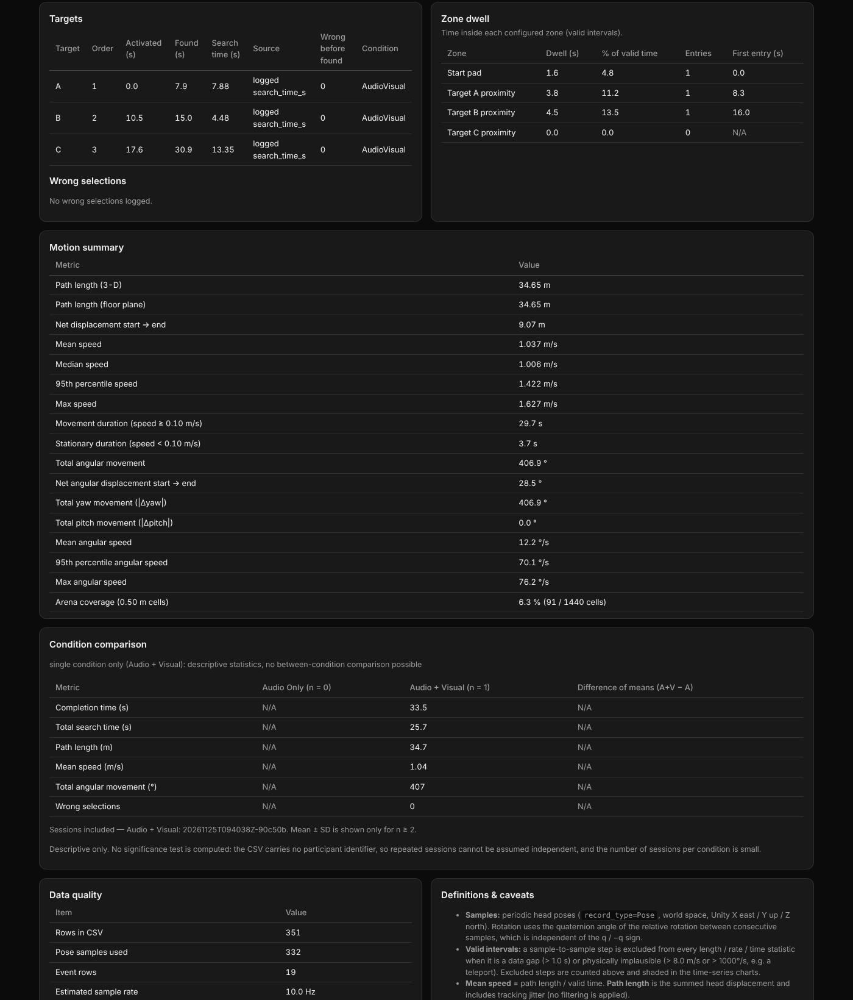

# Analytics — Automatic 6-DoF Analysis

When an experiment finishes, Unity automatically runs a Python script on the CSV it just saved, builds an interactive HTML report and opens it in the browser.

```
Find 3 sound sources → SessionRecorder saves and closes the CSV → AnalysisBridge runs Python
→ reports/<session_id>/report.html → browser opens
```

All screenshots below were taken on the development Mac (Unity 6000.6.10f1, XR Interaction Simulator, no headset).

## 1. Setup (once)

You need Python 3 on the machine (for example `brew install python`). Then either:

- Unity menu **Tools → Spatial Sound Hunt → Analytics → Set Up Python Environment**. It creates `.venv` inside the project and installs `Analytics/requirements.txt` (numpy, pandas, plotly, pytest). Needs internet.
- Or from the project root:

  ```bash
  python3 -m venv .venv
  .venv/bin/pip install -r Analytics/requirements.txt
  ```

Use **Check Python Environment** to confirm. The Console should print `Python OK`.



## 2. Usage

**Automatic.** Press Play (Game view needs focus), press Enter or click START, find the three sources.



After the third source the Console shows:

```
[SessionRecorder] Saved 488 rows (Completed) -> …/SpatialSoundHunt_session_….csv
[AnalysisBridge] Analysing … python: …/.venv/bin/python
[AnalysisBridge] Analysis finished in 5.3 s -> …/reports/<session_id>/report.html
```



**Manual** (Tools → Spatial Sound Hunt → Analytics):

| Menu item | What it does |
|---|---|
| Analyze Latest Session | Analyse the newest session CSV |
| Analyze CSV… | Pick any session CSV |
| Open Reports Folder | Open `reports/` |
| Check / Set Up Python Environment | Check or create `.venv` |
| Add Analysis Bridge To Open Scene | Add `AnalysisBridge` to an older scene |

**Command line** (no Unity needed):

```bash
.venv/bin/python Analytics/analyze_session.py --input <session.csv>
# default output: reports/<session_id>/   (--output to change, --open to open the report)
```

Every session gets its own `reports/<session_id>/` folder, so runs never overwrite each other.

## 3. The report

Title: **Spatial Sound Hunt — 6-DoF Exploration Analytics**. The page is a single offline HTML file.

Below is the report generated from a **real Unity session CSV** (Audio + Visual condition, 3/3 targets found, 351 rows). It is not simulated data.





Files in `reports/<session_id>/`: `report.html`, `summary.json`, `processed_poses.csv`, `events.csv`, `heatmap_xz_occupancy.csv`, `source_session.csv` (copy of the input).

## 4. How the numbers are computed (short)

- Position and rotation come from the `Pose` rows of the CSV. Time is `session_time_s`.
- Rotation uses the angle of the relative quaternion between consecutive samples, so `q` and `−q` give the same result.
- Intervals with a gap > 1 s, or speed > 8 m/s, or angular speed > 1000°/s are treated as gaps or tracking jumps. They are excluded from the statistics and their number is reported.
- Stationary threshold: 0.10 m/s.
- Task performance comes only from event rows (`TargetSelected` and so on). Anything the CSV does not contain is shown as N/A with the reason, never invented.
- The Audio Only vs Audio + Visual comparison is descriptive only. No significance test is computed (too few sessions per condition, no participant ID).
- Arena size and target positions come from the Builder's default layout (`Analytics/config.py`). A different scene layout needs `--config`.

## 5. What was verified, and what was not

| Item | Status |
|---|---|
| 45 Python tests (normal CSV, empty CSV, missing columns, duplicate timestamps, missing values, stationary, quaternion sign flip, single sample, analysis error, several sessions not overwriting) | Pass. Run on **synthetic data** in a Linux container (Python 3.13), not on the Mac `.venv` |
| `.venv` created on the Mac (Python 3.15, numpy 2.5, pandas 3.1, plotly 7.2) | Verified |
| Report from the real CSV via the Unity menu *Analyze Latest Session* (0.7 s) | Verified |
| Play Mode: finish 3 sources → CSV saved → Python started automatically → report written | Verified (Console log above). The 3 sources were selected with the Inspector debug menu, **not** with a controller ray |
| Report layout | Checked by rendering a copy of the real report in headless Chrome |
| Browser opens automatically | The call is logged and the system browser (Edge) window appeared. I did not capture the page in the browser |
| Controller-ray selection of the 3 targets followed by analysis | **Not tested** |
| "Data saved / Analysis finished" message in the world-space UI | **Not confirmed** (the player was outside the lab during that run, see below) |
| Python failure path inside Unity (experiment keeps running, CSV kept) | **Not tested in Unity.** Only the Python exit code for a failing analysis is covered by the tests |
| A second full run in the same Play session | **Not completed** (Enter restarts the task, the second run was not finished) |
| Standalone build | **Not tested** |
| Python tests on the Mac `.venv` | **Not run** |

## 6. Known issues and notes

- In one test run the player moved out of the lab at about 28 s and, with no floor outside, fell continuously. This is expected behaviour, not a bug. That run therefore contains 282 implausible-jump intervals (speed > 8 m/s). The analysis excluded them from the statistics and printed a warning in the report and in the Console. Restart keeps the current player position; it does not move the player back to the start pad.
- A standalone build does not know the project folder. Set `SPATIALSOUNDHUNT_PYTHON` (path to Python) and `SPATIALSOUNDHUNT_ANALYTICS` (path to the `Analytics` folder), or fill in *Python Executable* and *Analytics Folder* on the `AnalysisBridge` component.
- Do not commit `.venv/` and `reports/` to Git.
- The `NoSubscription` errors in the Unity Console come from Unity AI Assistant and are unrelated to this project.
