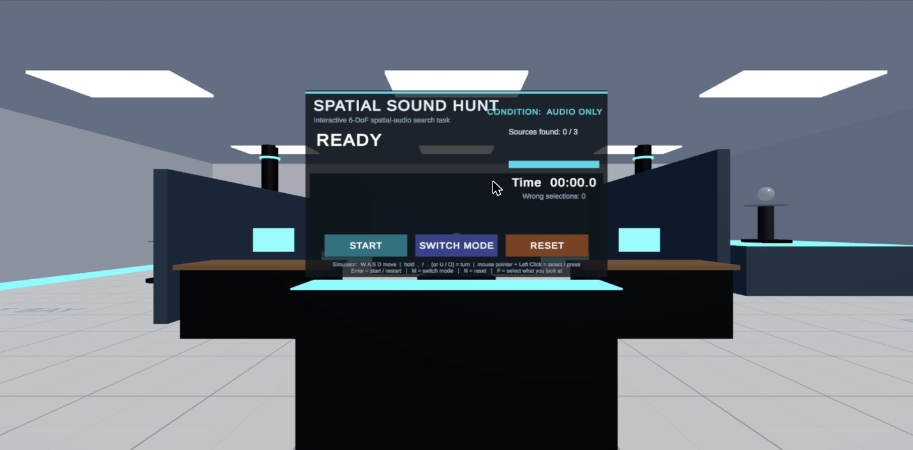
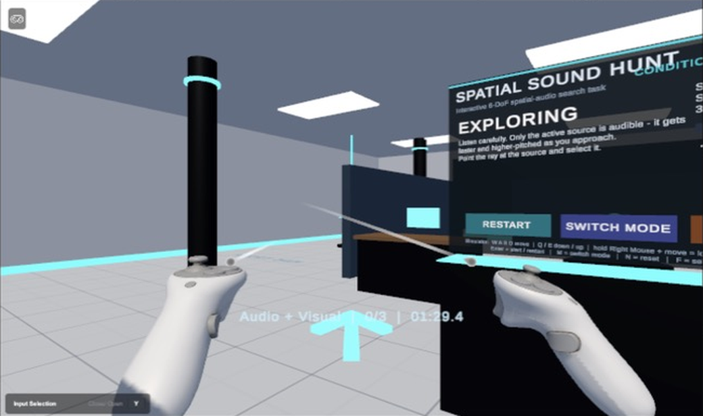
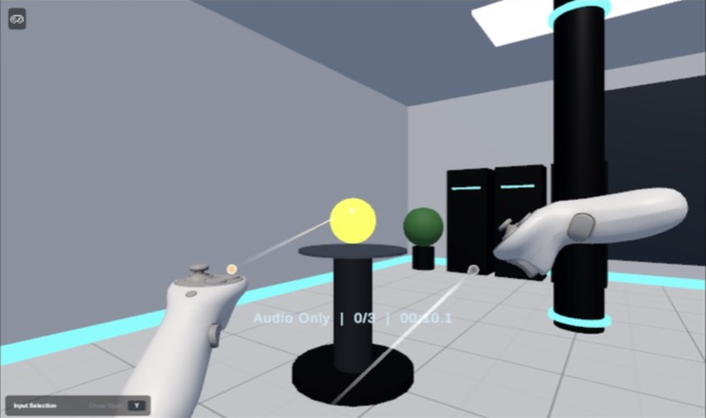
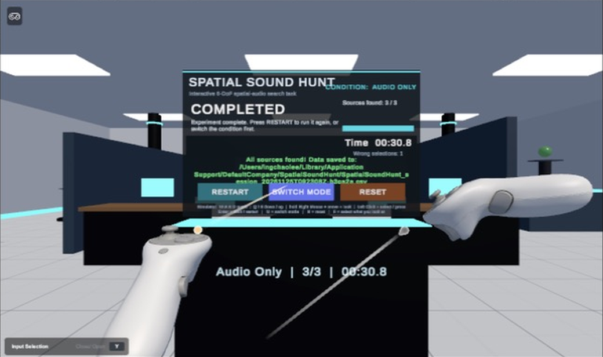
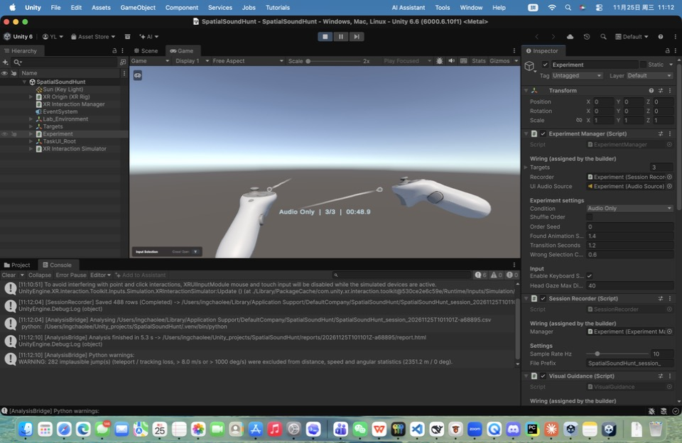
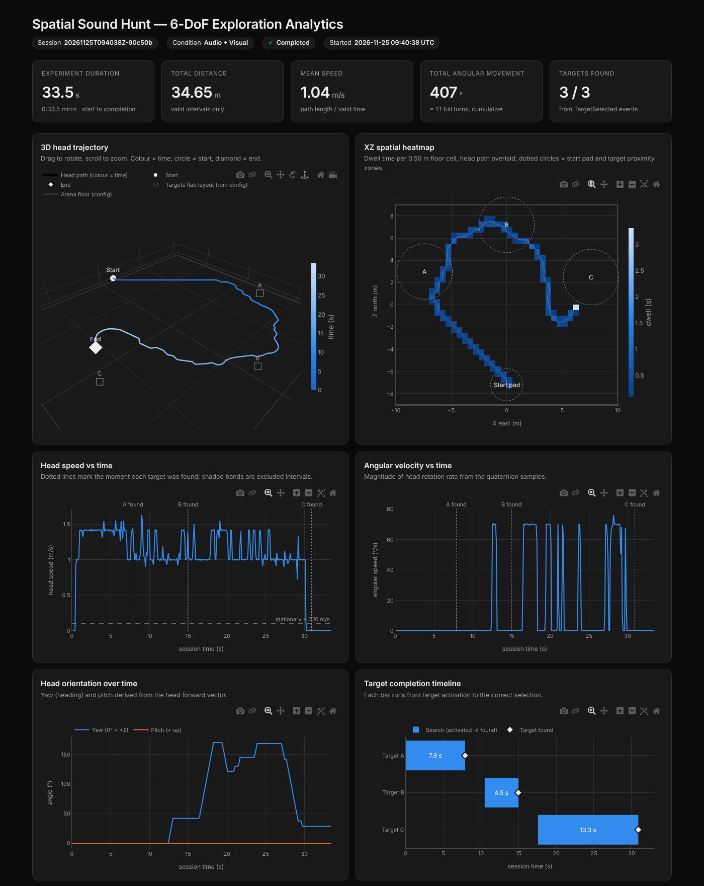

# Spatial Sound Hunt — Interactive 6-DoF VR Exploration Experiment

Unity 6 (6000.6.10f1) · URP · XR Interaction Toolkit 3.6.1 · Input System · no headset needed (XR Interaction Simulator + Play Mode)

In a virtual lab, the participant finds 3 hidden sound sources using **spatial audio only** (or audio + visual cues) and confirms each one with the controller ray.
The experiment runs as a state machine `Ready → Exploring → TargetFound → Transition → Completed` and writes the head 6-DoF pose and all events to a CSV file.
After each session a Python script analyses the CSV and builds an interactive HTML report (see [section 10](#10-python-6-dof-automatic-analysis)).

All screenshots in this README were taken on the development Mac (Unity 6000.6.10f1, XR Interaction Simulator, no headset).



*The world-space task console in the lab: state, condition, progress, timer, wrong-selection counter and the START / SWITCH MODE / RESET buttons.*

| Audio + Visual: guidance arrow | A sound source (orb on a pedestal) | Completed, data saved |
|---|---|---|
|  |  |  |

---

## 1. Verification status (read this first)

What was **actually run** in Unity 6000.6.10f1 on a Mac (Apple Silicon):

| Item | Result |
|---|---|
| Script compilation (runtime + Editor assemblies) | Pass. No errors or warnings from this project in the final Console |
| `Tools → Spatial Sound Hunt → Build Complete Demo` | Runs; generates and saves `Assets/Scenes/SpatialSoundHunt.unity` |
| `Validate Scene Setup` | All checks `[ok]` (single XR Origin / EventSystem / Interaction Manager / Simulator / AudioListener, 3 targets, Recorder, UI, teleport floor, AnalysisBridge) |
| Enter Play Mode | Works. Lab, task console, HUD and simulated controllers are visible |
| Keyboard: Enter = start, M = switch condition, N = reset | Works (Unity must be in front and the Game view must have focus) |
| Audio Only ↔ Audio + Visual switch | Works (UI shows `CONDITION: AUDIO + VISUAL`, guidance arrow appears) |
| Wrong-selection counter | Works (`Wrong selections: 1`) |
| 3 targets in sequence → Completed → Restart | Works. **Driven with the Inspector debug menu** (it raises the "selected" event), not with 3 real ray clicks |
| Real ray selection | Works: pointing the mouse at a sphere and clicking moved the progress 0/3 → 1/3 (only one target tested by hand) |
| CSV written | Console prints `Saved 312 rows (Completed) -> …/SpatialSoundHunt_session_….csv` |
| Python analysis | See [section 10](#10-python-6-dof-automatic-analysis) and `Analytics/README.md` |
| Template scenes | `BasicScene` / `SampleScene` files were not modified |

**Not verified** (do not treat as tested):

- The audio itself. I cannot hear it, so audibility, distance attenuation and the pitch change with distance are unverified.
- Checking the CSV content column by column by hand. (The Python analysis did read and parse real CSV files successfully.)
- The `F` key (head-gaze selection), and selecting all 3 targets with real ray clicks.
- The proximity cue sound, `Shuffle Order`, and the `Open Demo Scene` / `Open Session Data Folder` menu items.
- Any real headset or standalone build.

---

## 2. File layout

```
Assets/
  Editor/
    SpatialSoundHuntBuilder.cs                   ← menu Tools → Spatial Sound Hunt
    SpatialSoundHuntAnalyticsMenu.cs             ← menu Tools → Spatial Sound Hunt → Analytics
  Scripts/SpatialSoundHunt/
    ExperimentTypes.cs     state / condition enums
    ExperimentManager.cs   state machine, target order, correct/wrong logic, keyboard, debug menu
    SoundTarget.cs         one sound source: audio, visual feedback, XRSimpleInteractable events
    ProceduralAudio.cs     AudioClips generated at runtime (no external audio assets)
    SessionRecorder.cs     CSV recording
    VisualGuidance.cs      head-relative guidance arrow in the Audio + Visual condition
    TaskUI.cs              world-space console + head HUD
    HeadPose.cs            XR camera pose helper
    LookAssist.cs          easier turning with the keyboard (, / . or U / O)
    SimpleSpin.cs          decorative rotation
    AnalysisBridge.cs      after "Completed": runs Python on the CSV and opens the report
  Scenes/SpatialSoundHunt.unity                  ← generated by the Builder
  Materials/SpatialSoundHunt/*.mat               ← generated by the Builder (URP Lit)
  Textures/SpatialSoundHunt/LabFloor.png         ← generated by the Builder (procedural floor texture)
Analytics/                                       ← Python analysis (see Analytics/README.md)
docs/screenshots/                                ← screenshots used in this README
```

Merge the matching folders from `Assets/` into your VR Template project. **The scene, materials and texture are generated by the Builder**, so copying only `Scripts` and `Editor` is enough to get the complete demo.

---

## 3. How to use

1. Open the VR Template project with Unity 6000.6.10f1 and wait until compilation finishes (bottom-right).
2. Menu bar: **Tools → Spatial Sound Hunt → Build Complete Demo**
   (after the first compile a "Build now?" prompt may appear; confirming it is the same thing).
3. When "Demo scene built and saved." appears, the open scene is `Assets/Scenes/SpatialSoundHunt.unity`.
   To reopen it later: **Tools → Spatial Sound Hunt → Open Demo Scene**, or double-click the scene in the Project window.
4. Press Play. Switch to the **Game** view and **click once inside it (to give it keyboard focus)**.
5. Press Enter (or point the ray at START on the console) to begin.

What the Builder does: creates folders → generates materials / texture → copies `BasicScene` as a new scene (the original is untouched) → reuses its XR Origin, XR Interaction Manager and EventSystem → builds the lab (floor, walls, partitions, platforms, props, lights) → 3 sound sources → the `Experiment` object (manager + recorder + guidance + analysis bridge) → world-space UI → instantiates the **XR Interaction Simulator** (it does not appear automatically in the template) → saves → self-check.
It never creates a second XR Origin or EventSystem. Do not also enable "auto-instantiate simulator" in the XR Interaction Toolkit settings, or you will get two simulators.

Other menu items: `Validate Scene Setup` (self-check at any time), `Open Session Data Folder` (opens the folder with the CSV files).

---

## 4. Controls (XR Interaction Simulator)

**Input only works while Unity is in front and the Game view has focus** (click the Game view once).

| Action | Keys |
|---|---|
| Move | `W A S D`, `Q` / `E` down / up |
| Look around | Hold the **right mouse button** and move the mouse; arrow keys also turn the head (fast); hold `,` / `.` (or `U` / `O`) for easier keyboard turning |
| Aim and select | **Put the mouse pointer on the target and left-click** (simulator point-and-click: the pointer position sets the ray direction) |
| Press a console button | Same, click START / SWITCH MODE / RESET |
| Start / restart | `Enter` |
| Switch Audio Only ↔ Audio + Visual | `M` (also while running) |
| Reset to Ready | `N` |
| Head-gaze selection (fallback) | `F`: selects the source hit by the ray straight ahead of the head |
| Change controlled device | `Tab`; `[` `]` toggle left / right controller; `H` head only; `R` reset the simulator |

> Note: `M` overlaps the default binding of the controller "Menu" button in the simulator. It has no other use in this project, so it does no harm.

### Debug menu (Play Mode)

Select **Experiment** in the Hierarchy, then right-click the `Experiment Manager` component header (or use the ⋮ button) → **Debug**:

- `Select Active Target (correct)`: raises "selected" for the current target
- `Select Another Target (wrong)`: raises one wrong selection
- `Place Player 3 m In Front Of Active Target`: teleports the player 3 m in front of the current target, facing it

The third item is the fastest if you do not want to walk. They raise the same events as a real selection.

---

## 5. Experiment design

- 3 sound sources (A / B / C) that look identical. Only the "current target" plays sound. After it is found the next one starts. When all 3 are found the state is `Completed`.
- **Audio Only**: no visual cue at all, listening only.
- **Audio + Visual**: the current target gets a light beam / ring highlight, and a guidance arrow in front of the head points to it.
- The closer you are: slightly louder, higher pitch, faster beat. A proximity cue plays once when you enter the close range (not verified by listening, see section 1).
- Feedback: hover / selected colour change; correct → found animation + success sound; wrong → shake + error sound. The console shows state, condition, progress bar, timer, wrong-selection count, instructions and START / SWITCH MODE / RESET buttons.

---

## 6. Data (CSV)

Location: `Application.persistentDataPath/SpatialSoundHunt_session_<time>-<id>.csv`
In the macOS editor this is normally `~/Library/Application Support/DefaultCompany/SpatialSoundHunt/`.
Fastest way to open it: **Tools → Spatial Sound Hunt → Open Session Data Folder**.

Columns (defined by the code):
`timestamp_utc, session_time_s, session_id, condition, state, record_type, event, current_target, interacted_target, hmd_px, hmd_py, hmd_pz, hmd_qx, hmd_qy, hmd_qz, hmd_qw, details`

- `record_type = Pose`: head position + quaternion at about 10 Hz.
- Event rows (`record_type = Event`, also carrying the head pose): `SessionStart`, `StateChanged`, `TargetActivated`, `TargetSelected` (`details` has `result=Correct/Wrong`, input source Controller / HeadGaze / DebugMenu, search time), `ConditionChanged`, `ExperimentCompleted`, `ExperimentAborted`, `SessionEnd`.
- The file is closed on completion (`Completed`), on reset or restart (`Aborted` / `Restarted`) and when leaving Play Mode (`Interrupted`). The Console prints the row count and the path.

---

## 7. Spatial audio note

All 3 `AudioSource`s use `spatialBlend = 1` (fully 3D), logarithmic rolloff and no Doppler. The sound is synthesised in code at runtime, so no external assets are needed.
This is Unity's built-in 3D panning plus distance attenuation. **No** HRTF / Spatializer plugin is enabled, so this must **not** be described as verified HRTF binaural rendering. To use a Spatializer plugin, tick `useSpatializerPlugin` on `SoundTarget` and select the plugin in Project Settings → Audio.

---

## 8. Troubleshooting compile / run problems

1. **Console window** (Window → General → Console): red errors show `Assets/…/File.cs(line,column)`. Double-click to jump there.
2. If the menu `Tools → Spatial Sound Hunt` is missing, the scripts have not compiled yet. Fix the `error CS…` lines in the Console first.
3. Runtime problems: run **Validate Scene Setup**. It lists missing references.
4. Regenerate: run **Build Complete Demo** again (it overwrites `SpatialSoundHunt.unity` and the generated materials).
5. Build output: `Library/ScriptAssemblies/Assembly-CSharp.dll` (runtime) and `Assembly-CSharp-Editor.dll` (Builder).

### Known Console messages that are unrelated to this project

- `Loading OpenXR loader library at path …` shown as an error when Play starts: there is no OpenXR runtime on macOS, so the template's XR initialisation logs this. It does not affect the simulator. To silence it: Project Settings → XR Plug-in Management → Standalone, untick *Initialize XR on Startup*.
- `Failed to get haptic capabilities of XRSimulatedController …`: the simulated controller has no haptics. XRI warns once on ray hover / select. Harmless.
- `To avoid interfering with point and click interactions, XRUIInputModule mouse … disabled`: normal simulator message.
- `Error reason is 'NoSubscription' … generators.ai.unity.com`: subscription notice from the Unity AI features. Unrelated to this project and shown after every recompile.

---

## 9. Limitations

- No paid assets, third-party plugins, or Quest / Windows-only features are used.
- All APIs compile on the current Unity 6.6. `FindObjectsByType` / `FindAnyObjectByType` use the overloads without a sort parameter (older versions give obsolete warnings).
- The scene is made only of Unity primitives and procedural materials. There are no art assets.

---

## 10. Python 6-DoF automatic analysis

When an experiment finishes, Unity saves the CSV, runs Python on it, writes `reports/<session_id>/report.html` and opens it in the browser:

```
Find 3 sources → SessionRecorder saves and closes the CSV → AnalysisBridge runs Python
→ reports/<session_id>/report.html → browser opens
```

First time only: **Tools → Spatial Sound Hunt → Analytics → Set Up Python Environment** (creates `.venv` in the project, needs internet).
Manual analysis of any CSV: **Tools → Spatial Sound Hunt → Analytics → Analyze Latest Session / Analyze CSV…**. Command line: `.venv/bin/python Analytics/analyze_session.py --input <session.csv>`.

After the third source, the Unity Console shows the whole chain:



The report below was generated from a **real Unity session CSV** (Audio + Visual, 3/3 targets, 351 rows), not from simulated data:




Full list, metric definitions, command-line options and known issues: **`Analytics/README.md`**.
